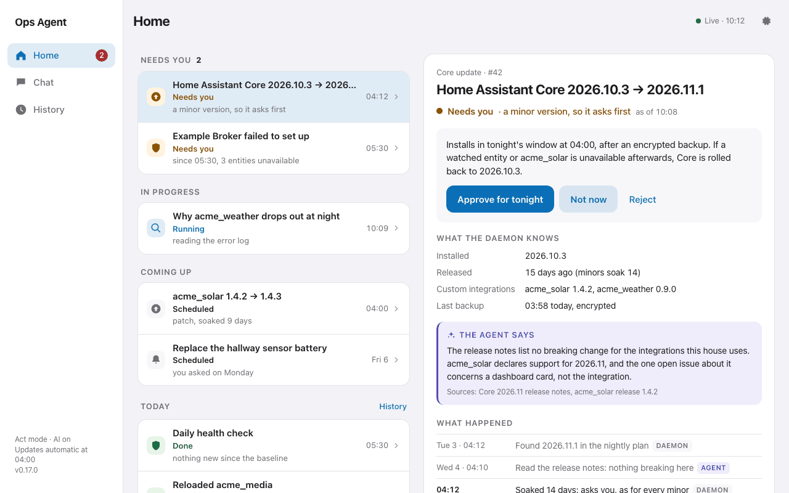
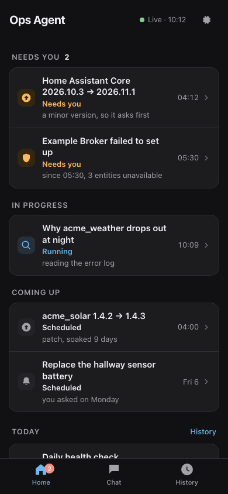

# ha-ops-agent

An unattended maintenance add-on for Home Assistant. It checks the system
every day, tells you only when something changed, installs updates that have
soaked with a backup, a health diff and rollback, and answers questions in
one admin chat. It uses an AI model for the parts that need judgement and
plain, tested code for everything that acts.



## What it does

- **Daily health check.** Repairs, Supervisor issues, error log patterns,
  unavailable entities, failed integrations, custom integrations, pending
  updates, backups, disk and memory are compared with an accepted baseline.
  Nothing new means no AI run and no push.
- **Triage when something changed.** The AI reads the difference
  (read-only) and the agent sends you one push through the Companion app if
  it matters. A broken custom integration always gets a push, whatever the
  AI says.
- **Nightly updates.** Every night it plans the pending updates. If you let
  it, patches and minor versions that have soaked (7 and 14 days by
  default) install one at a time in a window you choose, after an encrypted
  backup made with your own automatic backup settings, with a health check
  before and after each one and a rollback if things got worse. Majors,
  HAOS, firmware and anything in your profile's fragile list ask you first.
- **One chat.** Ask in the panel, or reply to a push. The chat can look
  things up, set reminders, start a longer investigation and ask you to
  approve an update. It never approves anything itself.
- **Approvals.** Anything that needs you appears under *Needs you* in the
  panel. An approval is bound to the exact action you were shown, is used
  once and expires.
- **Integration reload.** It may reload an integration you allowed (for
  example a stuck media integration), at most once per domain per 10
  minutes, and never one that controls a lock, an alarm or a door.
- **Config changes as proposals (optional, needs git).** If your
  configuration is a git repository, the agent can propose changes to
  automations, alerts and templates as commits that only you can apply.
- **Maintenance ahead.** Home Assistant announces deprecations several
  releases before it removes something. The agent matches repairs, Core log
  warnings, release notes, archived HACS repositories and Core integrations
  that now cover a custom one against what you use, and keeps one item for
  each with the removal version and a plan. It asks you only once a removal
  is two releases away; replacement candidates and suggestions wait under
  *Suggestions*. With git on, a YAML migration is a one-tap proposal. A
  dashboard migration is a plan you approve: the agent backs the dashboard
  up, saves the change, reads it back and restores the backup if anything
  differs. A Core update that would remove something you still use always
  asks.

Everything it does is an *item* on the panel's Home page, with its history.
It pushes only when an item needs you, when Home Assistant is down, or when
you asked for it.



The screenshots show sample data.

## Who it is for

Home Assistant OS (or Supervised) users who want routine maintenance done
for them and are comfortable letting a background agent install patch
updates, with a backup and rollback, under rules they can read. It suits a
single administrator. If you prefer to install every update by hand, run it
in `observe` mode: you get the health check, triage and chat, and it changes
nothing.

## Requirements

- Home Assistant OS or Supervised. Container and Core installs are not
  supported: the add-on needs the Supervisor for backups, updates and its
  panel.
- An `aarch64` or `amd64` machine with at least 2 GB of RAM (an AI run
  starts only with 1.2 GB free).
- The Companion app on the admin's phone, for pushes.
- AI access, for triage, chat and release-note reviews (see
  [AI access](#ai-access)). Without it, set `llm.provider: none`: you still
  get the deterministic health check, pushes and approvals, but automatic
  updates wait for your approval because their release notes cannot be
  reviewed (`updates.hold_if_unreviewed`).
- Automatic backups configured in Home Assistant, with encryption (Settings
  > System > Backups). The agent backs up through them and never sees your
  backup password.

## Install

1. Settings > Add-ons > Add-on store > ⋮ > Repositories, and add
   `https://github.com/dipeshc/ha-ops-agent`.
2. Install **HA Ops Agent**. The Supervisor builds the image on your
   machine from the pinned base image and pinned packages, including the AI
   client (see [AI access](#ai-access)). No prebuilt image is published.
3. Configure it (below), start it, and open **Ops Agent** in the sidebar.
   Only the admin can use the panel: the Home Assistant administrator who
   owns the push device in `notify.service`.

The first health check accepts today's state as the baseline and sends one
summary push. Broken custom integrations are never accepted silently; they
are reported again until you accept them in the panel.

## AI access

The agent reaches its AI model through a provider, chosen with
`llm.provider`. Today the provider is `claude`: the agent runs Claude Code
headless, which the image installs at build time, at a pinned version, from
Anthropic's signed package repository.

- **Sign-in.** Paste a Claude Code setup token into `claude.token`: run
  `claude setup-token` on your own computer (it needs a Claude Pro or Max
  subscription). A setup token is the only sign-in supported today. The
  token stays on your Home Assistant machine and is only passed to Claude
  Code.
- **Models.** `claude.model_standard` (default `claude-sonnet-5-5`) is used
  for triage and chat; the optional `claude.model_fast` for chat
  summaries.
- **Spend.** `usage.max_share_percent` (default 5) caps how much of each
  subscription usage window the agent may use, and `limits.run_max_usd`
  caps each run's estimated cost.

`llm.provider: none` turns the AI off. The health check, pushes, approvals
and the update rules keep working, but automatic updates wait for your
approval, since their release notes cannot be reviewed (unless you turn
`updates.hold_if_unreviewed` off).

## Configuration

The add-on options hold behaviour; the house profile holds what is specific
to your home. The main options:

| Option | Default | What it does |
| --- | --- | --- |
| `agent.mode` | `observe` | `observe` reports only. `act` lets it install updates (with `updates.auto_install`), make backups and reload allowed integrations. |
| `llm.provider` | `claude` | The AI provider; `none` runs without AI. See [AI access](#ai-access). |
| `notify.service` | | Your Companion app notify service, e.g. `mobile_app_my_phone`. Empty: the profile's `notify_service`. |
| `notify.max_pushes_per_day` | `3` | Normal pushes per day. Safety pushes have their own small budget. |
| `notify.quiet_start` / `quiet_end` | `22:30` / `07:00` | Non-urgent pushes wait until the end. Empty turns quiet hours off. |
| `health.check_time` | `05:30` | Daily health check. |
| `health.expected_unavailable` | `[]` | Entities that are normally unavailable and are not news. |
| `updates.window` | `04:00` | Nightly update window. |
| `updates.auto_install` | `off` | `on` installs soaked patches and minors (needs `agent.mode: act`). |
| `updates.min_age_days` | `7` | Soak time for patches (7 minimum); minors wait twice as long. |
| `updates.review` | `true` | The AI reads release notes and may hold an update back, never the reverse. |
| `updates.need_approval` / `never` | `[]` | Update entities that always ask, or are never offered. |
| `capabilities.reloadable_domains` | | Integrations it may reload, comma-separated. Empty: the profile's `reload.domains`, else none. |
| `capabilities.require_approval` / `never` | `[]` | Tighten any capability by name. Options never loosen a built-in limit. |
| `usage.max_share_percent` | `5.0` | Share of a subscription window the agent may use. |

The provider's own options are described under [AI access](#ai-access).
Unused optional keys (`limits.*` and the provider's optional ones) are
shown with "Show unused optional configuration options". Invalid options
make the agent fail closed: it observes only, installs nothing and runs no
AI until they are fixed.

### The house profile

The profile is an optional file, `ops/profile.yaml` in your Home Assistant
configuration directory. It is read when the add-on starts, so restart the
add-on after changing it. Without it the agent is generic: no fragile
pieces, no watched entities, no reloadable integrations, git off.
[`examples/profile.yaml`](examples/profile.yaml) has every key, commented.

| Key | What it is for |
| --- | --- |
| `notify_service` | The push target when the `notify.service` option is empty. |
| `self_slug` | The add-on's slug, for links in pushes. Detected automatically; set it only if push links open the wrong page. |
| `health.power_entity`, `health.remote_entity` | Optional binary sensors the daily check reports on (power supply, remote access). |
| `updates.need_approval` | Update entities that always ask, added to the option of the same name. |
| `updates.watched_entities` | Entities that must still be available after an update. If one is not, a Core or HACS update rolls back; an add-on, HAOS or firmware update is escalated to you. |
| `updates.fragile[]` | Integrations that have broken before: `name`, `tier` (`approve`, `pinned` or `never`), `reason`, and `entities`, `repos` or `domains` to match. Optional `bumps` limits it to `patch`, `minor`, `major` or `unknown` versions. |
| `updates.version_gates[]` | Hold Core from `core_from` on for an `integration`, with a `reason`, until you change the profile. |
| `reload.domains`, `reload.deny` | Integrations it may reload, and extra ones it never reloads. |
| `git.enabled`, `author_name`, `author_email`, `proposals` | Config changes as git proposals (`automations`, `alerts`, `templates`). Needs the configuration directory to be a git repository. |
| `dashboards.generated` | Storage dashboards something else writes; the agent never edits them. |
| `docs.runbook`, `docs.facts`, `docs.readable` | Markdown files and folders the agent reads first. `facts` must be `docs/<name>.md`; nothing under `ops/`. |
| `house_notes` | A few lines of background in plain words. |
| `overlays` | Optional extra modules a custom build adds under `opsd/house/`. This repository ships none, so leave it out. |

How to write one:

1. Start with `updates.watched_entities`: the few things that must keep
   working after an update (locks, the alarm, the heating).
2. Add `updates.fragile` for integrations that have broken on updates
   before. Their updates always ask you, or never install if pinned.
3. List the integrations it may reload under `reload.domains`. Locks,
   alarms, garage doors, radios and core plumbing are refused whatever you
   list.
4. Optionally write a short runbook and `house_notes`: who uses what, what
   matters, what to leave alone. The agent reads them as background data; they
   cannot grant the agent any permission.

The schema is strict. An unknown key or a bad value refuses the whole file,
and the agent fails closed, as with invalid options, until it is fixed. The
panel's System sheet shows whether the profile loaded and why it was
refused. No profile value can weaken a safety rule: fragile pieces only hold
updates back and `reload.deny` only adds to the never-reload list.

## Safety model

The agent is built so that a wrong or manipulated AI answer cannot do
much harm.

- **The daemon acts; the AI only proposes.** The AI runs as an
  unprivileged user in the add-on, in a read-only copy of the config files
  that are safe to read. Its tools are read-only, plus a shell that can
  run only the `opsctl` command and, in chat and investigations, a write
  tool confined to proposal drafts. Through `opsctl` it can ask the daemon
  for a small set of named actions over a local socket. The
  daemon checks each request against the run's allowed capabilities, quotas
  and your options, records it, and carries it out itself.
- **The AI never sees secrets.** The Supervisor token, your live config,
  backups and the add-on's data are out of its reach at the operating
  system level. The add-on checks this before every run and refuses to
  start the AI if anything is reachable.
- **Locks, alarms and doors are off limits.** The agent has no capability to
  operate them and never reloads an integration that controls one. If one
  is exposed to Assist, the health check reports it as critical.
- **You approve what is risky.** Majors, HAOS, firmware, fragile
  integrations, held versions and config changes ask you in the panel. An
  approval covers exactly what you were shown and is used once.
- **Updates are reversible or they ask.** Every automatic update has a
  backup, a health comparison and a rollback path. An update without a
  precise rollback asks you first. A version that was rolled back is held
  until you approve it again in the panel.
- **The agent never changes itself**, the Supervisor or the host, except an
  operating-system update you approved.
- **Untrusted text is data.** Device names, logs, release notes and chat
  messages are passed to the AI as fenced data, never as instructions.
- **Bounded.** Daily run caps, turn and time limits, a memory guard and a
  kill switch in the panel. Pushes have a daily budget.
- **Git is plumbing only.** Proposals are commits on a separate ref. Only
  you apply them, after a config check; pushes are fast-forward only.

Trust assumptions: the agent's admin is the Home Assistant user who owns
the push device in `notify.service`, and must be an active administrator.
Code running in your Home Assistant frontend (another add-on's panel, a
custom card) could act as you in the panel. See
[SECURITY.md](SECURITY.md).

## Limitations

- One admin: the owner of the push device. Other users, administrators
  included, cannot use the panel or its approvals.
- English only: prompts, panel and the word lists that recognise doors and
  garages by name.
- The image pins exact Alpine and AI client versions. When upstream
  rotates a package, the build fails until the add-on is updated; it never
  picks up a different version silently.
- Rollback covers Core (when the database schema did not change) and HACS
  integrations. Add-ons, HAOS and firmware regressions are escalated to you,
  not restored.
- The AI's triage is advice. The health check, update rules and limits are
  deterministic code, and they are what protects the house.
- Dashboards change only through a maintenance plan you approved; areas and
  other UI-stored settings are not edited.

## Support

Best effort, through [GitHub issues](https://github.com/dipeshc/ha-ops-agent/issues)
only. Attach the diagnostics export from the panel (System > Download
diagnostics). Report security problems privately, as described in
[SECURITY.md](SECURITY.md).

## Development

```sh
uv sync
uv run ruff format --check && uv run ruff check
uv run mypy
uv run pytest
```

The add-on lives in [`ha_ops_agent/`](ha_ops_agent); its Python code is in
`ha_ops_agent/rootfs/opt/ops/opsd`.

## Licence

Apache-2.0. See [LICENSE](LICENSE) and [NOTICE](NOTICE).
